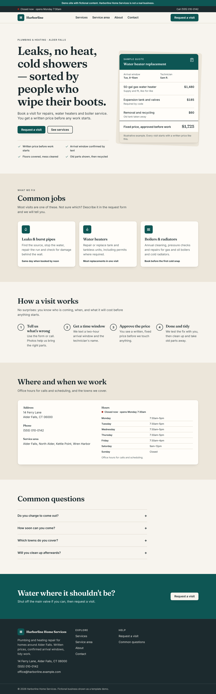

# Forge-CT Super Site Template

A reusable website foundation for small-business and product sites. One codebase builds many distinct client sites, each from **one typed config file**. Every page is **prerendered to static HTML**. The template is honest about what it doesn't know, and **nothing is indexable until it is deliberately launched**.



## Highlights

- **One config per site.** Each `sites/<id>/site.config.ts` is validated by zod at build time. Broken configs fail the build with a readable list of problems.
- **13 composable sections:** hero, features, steps, testimonials, CTA band, FAQ, contact, hours/location, catalog, events, pricing, rich text and posts. Reorder or hide them, or add new ones, without touching the others.
- **Facts carry a status and a source.** Phone numbers, addresses, hours and app URLs are each `confirmed`, `unconfirmed` or `demo`:
  - Demo values are tagged on the page and never linked.
  - Only confirmed facts reach structured data (JSON-LD).
- **Launch gate.** `--production` builds refuse to run while anything is still demo, unconfirmed or a sample, and they check before writing any output.
- **Indexing is opt-in.** Previews and demos ship with meta `noindex`, an `X-Robots-Tag` header, `robots.txt` Disallow and no sitemap.
- **Honest integrations.** Forms report "demo: nothing sent", "finish in your email app" or "sent" only on a real 2xx response. The catalog provider returns ok, empty or unavailable, and each state renders differently.
- **Accessible by default.** Skip link, landmarks, keyboard-operable mobile menu, focus management, `aria-live` results, reduced motion. Checked with axe in CI-style browser tests.
- **Small.** About 82 KiB gzipped JS per site, almost all of it React. Pages are fully readable without JavaScript.

## Example sites (fictional)

| | Family | Look |
|---|---|---|
| **Harborline Home Services** | Local service (plumbing & heating) | Warm paper, serif headings, soft shadows |
| **Lantern & Lair Games** | Game store with catalog, events, news | Dark, monospace uppercase, hard shadows |
| **Tallyhook** | Product / app landing | Crisp white, tight sans, pill buttons |

All names, addresses, phone numbers (555-01xx), emails (`*.example.com`), products, events and prices are invented and labelled as demo content. Details: [EXAMPLE_SITES.md](EXAMPLE_SITES.md). Screenshots: [`docs/screenshots/`](docs/screenshots/).

## Quick start

Requires Node 22+.

```bash
npm ci --ignore-scripts
npm run check                          # typecheck, lint, format, unit/component tests, build all, output tests
npm run test:e2e                       # Playwright + axe against the built sites (after build:all)
npm run preview -- --site lantern      # http://127.0.0.1:4173
```

No credentials, environment variables or external services are needed to build or preview.

**Vercel:** import the repo as-is. The root `vercel.json` builds the site named by the `SITE` environment variable (default `harborline`) and serves it. Set `SITE=lantern` or `SITE=tallyhook` to show another example. Details: TEMPLATE_IMPLEMENTATION.md → *Deploying to Vercel*.

## Documentation

| Document | Contents |
|---|---|
| [ARCHITECTURE.md](ARCHITECTURE.md) | Stack choice, alternatives, trade-offs, design decisions |
| [TEMPLATE_IMPLEMENTATION.md](TEMPLATE_IMPLEMENTATION.md) | Project structure, feature status, integration boundaries, how to add a site or section |
| [DESIGN_SYSTEM.md](DESIGN_SYSTEM.md) | Tokens, component rules, accessibility expectations, branding a client |
| [EXAMPLE_SITES.md](EXAMPLE_SITES.md) | The three demo sites and what each demonstrates |
| [VALIDATION.md](VALIDATION.md) | Checks run for this publication and their results |

## Limitations

- Demo deployments are `noindex` by design. Production use requires the launch gate (`--production`) and confirmed facts.
- The live, indexable production path is covered by unit tests on a test-only config, not by a real launched site.
- Automated accessibility checks pass, but this is **not** an accessibility certification. Manual screen-reader testing is still needed.
- Out of scope: checkout and payments, CMS adapters, self-hosted fonts and an image pipeline. See ARCHITECTURE.md.
